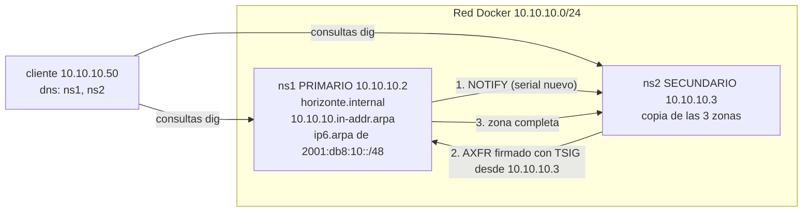

# Actividad 2 — DNS autoritativo de la U.E. Horizonte con BIND9

Proyecto del grupo Ubuntu de la materia Tecnología Web I (UPDS). Levanta con Docker un DNS autoritativo para el dominio de laboratorio `horizonte.internal`: un servidor primario (`ns1`), un secundario (`ns2`) y un cliente que usa ese DNS. Incluye zona directa e inversa (IPv4 e IPv6), transferencia de zona restringida por IP y por clave TSIG, registros de BIND y un verificador propio.

## Arquitectura



Los tres contenedores usan la misma imagen (`Dockerfile`: Ubuntu 24.04 con systemd y BIND 9.18). El repositorio se monta en `/lab` y los scripts instalan de allí la configuración.

## Requisitos

- **Docker Engine** (Linux o WSL) o **Docker Desktop**, con **Docker Compose v2** (`docker compose`).
- Permiso para contenedores `privileged` y **cgroup v2** (los nodos ejecutan systemd; `cgroup: host`).
- Subred `10.10.10.0/24` libre en Docker.
- Conexión a internet en el primer arranque (imagen Ubuntu y paquetes de BIND).
- Git y Bash (en Windows: Git Bash o WSL).

## Inicio rápido

```bash
git clone https://github.com/TW1-GrupoUbuntu/Actividad_2.git
cd Actividad_2
bash scripts/levantar.sh
bash scripts/verificar_zonas.sh
```

Resultado esperado de `verificar_zonas.sh`:

```text
== 1. Sintaxis (named-checkconf / named-checkzone)
✅ named-checkconf en ns1
...
Resultado: 38 de 38 comprobaciones
```

Notas:

- `levantar.sh` construye la imagen, enciende los contenedores, instala `ns1` y luego `ns2`. Es repetible.
- La clave TSIG se genera al instalar `ns1` en `compartido/transferencia.key`. Esa carpeta está en `.gitignore`: la clave nunca se sube al repositorio ni se muestra.
- Los archivos están en formato LF (`.gitattributes`). En Windows, si Git convierte los finales de línea, ejecutar `git config core.autocrlf input` antes de clonar.
- El verificador sale con código distinto de cero si alguna prueba falla; `AUTOR="Nombre" bash scripts/verificar_zonas.sh` añade una firma al final.

## Estructura

| Ruta | Contenido |
|---|---|
| `docker-compose.yml`, `Dockerfile` | `ns1`, `ns2` y `cliente` en la red `10.10.10.0/24` |
| `ns1/` | `named.conf.options`, `named.conf.local` y las tres zonas (`db.horizonte.internal`, `db.10.10.10`, `db.2001.db8.10`) |
| `ns2/` | Configuración del secundario |
| `scripts/levantar.sh` | Construye, enciende e instala todo |
| `scripts/instalar_ns1.sh`, `scripts/instalar_ns2.sh` | Instalan la configuración dentro de cada servidor, validando antes de aplicar |
| `scripts/verificar_zonas.sh` | Verificador propio de 38 pruebas |
| `scripts/subir_serial.sh` | Sube el serial (`AAAAMMDDnn`), valida con `named-checkzone` y recarga |
| `scripts/radiografia_dns.sh` | Diagnóstico de un dominio real (delegación, SOA, SPF, DMARC, CAA, DNSSEC) |

## Diseño de la zona

| Registro | Valor |
|---|---|
| SOA | `ns1.horizonte.internal. ti.horizonte.internal.`, refresh 3600, retry 600, expire 1209600, negativo 300 |
| NS | `ns1`, `ns2` |
| A / AAAA | `www` → 10.10.10.20 / 2001:db8:10::20 |
| CNAME | `portal` → `www` |
| MX / TXT | `10 mail` / `"v=spf1 mx -all"` |
| CAA | `0 issue "horizonte.internal"` |
| SRV | `_ldap._tcp` 10 100 389 `ldap` |
| PTR | IPv4 en `10.10.10.in-addr.arpa`, IPv6 en `0.1.0.0.8.b.d.0.1.0.0.2.ip6.arpa` |

- **TTL 3600:** equilibrio entre carga y frescura; antes de una migración se baja a 300 y se sube después.
- **TTL negativo 300:** un nombre recién creado se ve en pocos minutos.
- **Serial `AAAAMMDDnn`:** debe subir en cada cambio; si no sube (o baja), el secundario no copia la zona. `scripts/subir_serial.sh` lo automatiza.
- **Zonas inversas:** los nombres de la izquierda son el último octeto (o los nibbles, en IPv6) y los PTR llevan punto final.

## Transferencia restringida

`ns1` concede la transferencia solo si se cumplen **las dos** condiciones: el origen es `10.10.10.3` (`ns2`) y la petición va firmada con la clave TSIG `transferencia-horizonte`:

```text
allow-transfer { !{ !10.10.10.3; any; }; key "transferencia-horizonte"; };
```

`verificar_zonas.sh` prueba las cuatro combinaciones (cliente sin clave, cliente con clave, `ns2` sin clave, `ns2` con clave); solo la última se permite. Los registros quedan en `/var/log/named/transferencias.log` (`denied` y `AXFR ended` en `ns1`; `TSIG transferencia-horizonte` en `ns2`).

## Comandos útiles

```bash
# Consultas desde el cliente (usa el DNS propio, sin @)
docker exec cliente dig www.horizonte.internal
docker exec cliente dig -x 10.10.10.25
docker exec cliente getent ahostsv4 www.horizonte.internal

# Validar a mano
docker exec ns1 named-checkconf
docker exec ns1 named-checkzone horizonte.internal /var/lib/bind/db.horizonte.internal

# Cambiar la zona con serial nuevo (dentro de ns1)
docker exec ns1 bash /lab/scripts/subir_serial.sh horizonte.internal /lab/ns1/db.horizonte.internal

# Resolución real paso a paso
docker exec cliente dig +trace +nodnssec @1.1.1.1 www.upds.edu.bo
docker exec cliente bash /lab/scripts/radiografia_dns.sh upds.edu.bo
```

## Detener y limpiar

```bash
docker compose down          # apaga y elimina contenedores y red
rm -rf compartido            # borra la clave TSIG generada (puede requerir sudo: la crea root)
```
